# Complementary compute-market integration plan

State slice for this document: **`hyperintel-repository-foundation-v1`**.

This is a planning document only. It authorizes no product-code changes,
network access, credentials, provider execution, seller reservation, testnet or
mainnet writes, custody, settlement, publication, or value movement.

Planning baseline: repository `HEAD` is `d52111a07baa5fc4a7f6bfb4407731e2b9f609dc`
on `main`. The working tree is dirty. It already contains uncommitted changes
for the read-only federated offer catalog and hermetic runtime composition,
along with unrelated execution, persistence, and provider-agent changes. This
plan preserves those bytes and treats the catalog work as a candidate starting
point, not as a committed or independently reviewed capability. Source pins
and current reuse boundaries are recorded in `docs/provenance.md` in the
working tree.

## Recommendation

Connect the projects as independent services through narrow, versioned
adapters. Do not combine their repositories or import their runtime stacks.

- **Simple Compute Market** contributes buyer discovery, federated listing
  registries, seller-operated storefront negotiation, and seller-owned
  fulfillment. It documents separate discovery, seller, resource-service, and
  settlement roles; its current README describes both Alkahest escrow and
  hosted fiat settlement paths. HyperIntel should consume those role patterns
  through adapters and keep the buyer free to choose registries and sellers.
- **The Compute Bazaar** contributes market observations, normalized price and
  availability analysis, GPU fleet operations, and agent evaluations. Use
  those data and operations concepts first. Its README describes Trade as a
  place to explore compute price and availability hedges, not as a ready-made
  job-settlement path. Treat every observation and model output as advisory
  until independently qualified for a specific use.
- **HyperIntel** remains the inference policy, offer-authentication, assurance,
  deterministic routing, local execution, and receipt-reconciliation layer.
  It may build a non-authoritative deal/evidence identity that binds the
  accepted quote to the existing execution and settlement-intent records.
- **HyperEVM** is the proposed escrow and settlement rail for a later paid
  compute phase. A chain commitment records contract state and event ordering;
  it does not prove that a model ran correctly or that a provider's external
  claims are true.
- **JustAI** is an optional evidence-schema and disclosure reference, not a
  currently authorized marketplace custody service. Its local bridge is
  metadata-only, and its custody package records references without selecting
  a custody root or signer. Its current status closes provider calls, paid
  execution, live trading, and external actions. Any deal-record adapter or
  actual evidence custody therefore requires a separate charter/state-slice
  decision. JustAI must not receive authority to run workloads, approve
  inference, adjudicate semantic correctness, or move funds.

This plan extends the existing HyperIntel product direction: policy-gated
inference capacity, deterministic route and settlement intents, and eventual
HyperEVM escrow. It does not change the product into a general GPU rental
exchange, outcome market, or compute-derivatives venue.

## Target system and deal flow

```mermaid
flowchart LR
  CB[Compute Bazaar observations<br/>price, supply, availability] --> A[Bazaar read adapter]
  R[Simple Compute Market<br/>federated registries] --> B[Buyer-selected registry adapter]
  A --> C[HyperIntel offer catalog]
  B --> C
  U[Buyer policy and spend cap] --> D[HyperIntel router]
  C --> D
  D -->|eligible candidate| S[Seller storefront<br/>firm quote and negotiation]
  S -->|accepted quote| Q[Canonical deal envelope]
  U --> Q
  Q -->|authorized terms| E[HyperEVM escrow<br/>future gated phase]
  S --> P[Seller-owned resource service]
  P --> X[Offchain inference fulfillment]
  X --> M[Signed execution and metering receipts]
  M --> V[Configured verifier or dispute path]
  V --> E
  E --> I[Read-only event index and reconciliation]
  M --> I
  I --> J[Optional JustAI evidence custody<br/>and bounded public report]
```

### End-to-end sequence

1. **Observe supply.** Compute Bazaar supplies a market view or observation
   snapshot with its source, observation time, dataset/version identity, and
   freshness metadata. Its asking-price and availability estimates inform
   buyer planning and stale-data warnings; they do not authorize routing,
   escrow release, or provider payment.
2. **Discover listings.** The buyer chooses which Simple Compute Market
   registries to query. A registry is a discovery surface, not the seller or
   settlement authority. The seller publishes and maintains its own offer and
   storefront.
3. **Normalize and verify.** A HyperIntel adapter converts supported listing
   fields into HyperIntel's inference-native `ServiceSpecV1`,
   `CapacityOfferV1`, and `SignedCapacityOfferV1` inputs. The catalog verifies
   provider signatures against caller-owned trust, retains discovery
   provenance, deduplicates exact offer identities, and rejects stale,
   malformed, or conflicting rows. Registry names and Bazaar observations
   remain source claims; they do not become trust roots.
4. **Apply buyer policy.** HyperIntel applies hard service, region, assurance,
   privacy, replay, and spend-cap requirements before optimizing expected
   successful cost. Bazaar price or availability data can be displayed or used
   as explicitly versioned advisory inputs. They cannot silently change an
   offer's signed price, assurance, reliability evidence, or eligibility.
5. **Negotiate with the seller.** The buyer sends the eligible offer reference
   and bounded request to the seller-operated storefront. The storefront
   returns a firm quote and deal terms. HyperIntel rechecks that quote against
   the buyer's policy and cap; negotiation may not widen the buyer's
   authorization.
6. **Freeze deal terms.** Before any escrow or job launch, create a canonical,
   versioned deal envelope binding the buyer and seller identities, service
   digest, exact offer and quote digests, job-specification digest, asset and
   chain identity, maximum amount, fee allocation, expiry, milestones,
   timeout behavior, and dispute policy. Keep prompts, outputs, credentials,
   and private evidence off public chain state.
7. **Authorize settlement separately.** In a future explicitly authorized
   HyperEVM slice, the buyer funds or authorizes a capped escrow. The contract
   enforces the frozen terms, replay protection, expiry, and conservation of
   payout, fees, refund, and any objective credit. It does not inspect private
   inference payloads or decide subjective output quality.
8. **Fulfill offchain.** The seller-owned resource service provisions and runs
   the workload. It emits signed start, usage, completion, and failure records
   bound to the deal and request commitments. HyperIntel reconciles these with
   its authenticated execution lineage. A provider signature or hardware
   telemetry is attributable evidence, not independent proof of correct
   computation.
9. **Resolve and reconcile.** A named verifier or dispute mechanism applies
   only the deal's explicit objective rules. Missing, stale, conflicting, or
   unsupported evidence yields `INCONCLUSIVE`, `UNSUPPORTED`, or manual
   resolution; it never implies payment acceptance. A read-only indexer
   reconstructs chain events and links them to the offchain receipt digests.
10. **Retain and report evidence.** HyperIntel emits identity-only receipt
    references. A future JustAI bridge may accept an explicitly permitted
    metadata receipt and produce a bounded projection after its review and
    disclosure rules pass. The current bridge does not ingest or copy restricted
    bytes, and the current custody package does not operate a storage backend.
    Evidence bytes remain with a separately named, authorized custodian unless
    a new custody capability is independently approved.

## Responsibility and trust boundaries

| Component | Owns | Does not establish or control |
|---|---|---|
| Compute Bazaar data | Market observations, normalized views, price and availability analysis, fleet operations, agent evaluations | A provider's signed offer, live capacity at the moment of purchase, completed delivery, correct inference, or payment entitlement |
| Simple Compute Market registry | Listing publication, search, and registry-specific curation | Seller identity beyond its own verification policy, seller fulfillment, escrow, or HyperIntel buyer policy |
| Seller storefront | Seller pricing, negotiation, accepted quote, and seller-side coordination | Buyer cap expansion, HyperIntel route eligibility, independent verification, or buyer funds |
| Seller resource service | Provisioning, workload execution, and provider-side operational telemetry | Model correctness, independent metering, or settlement finality |
| HyperIntel | Buyer policy, provider-offer signature checks, assurance gates, route and replay reconstruction, execution receipt lineage, and non-authoritative settlement intent | Network source truth, seller performance, arbitrary dispute outcomes, key custody, or payment submission in the current slices |
| HyperEVM contracts and operator | Capped escrow transitions, replay-safe settlement, and ordered public events after future approval | External service delivery, semantic output truth, prompt privacy, or production authorization by themselves |
| Verifier / dispute path | A narrowly specified evidence decision under named trust and policy | More assurance than its procedure, independence, and evidence actually support |
| JustAI, if separately approved | Metadata-only evidence receipts, provenance and disclosure contracts, and bounded claim projections; a future deal-specific adapter would be new work | Current marketplace deal authority, raw-evidence storage, custody-root selection, workload execution, provider selection, escrow release, funds movement, or truth beyond reviewed evidence |

### Deal and receipt binding

The canonical deal identity should include at least:

- schema and protocol versions;
- buyer and seller/provider identities and the key purposes used;
- service-manifest digest, exact signed offer digest, and accepted quote digest;
- job-specification digest and private payload commitment (never the payload);
- chain ID, escrow-contract identity, settlement asset identity, and amount cap;
- fee split, expiry, allowed milestones, timeout/refund behavior, and dispute
  policy version;
- execution-admission, replay-consumption, journal, completion, metering,
  verifier-decision, and settlement-event digests when each exists.

The current `SettlementIntentV1` is non-authoritative local data. Do not treat
it as a signed storefront quote, funded escrow, chain transaction, payment, or
settled fill. Keep the deal envelope additive and versioned so this integration
does not alter existing V1–V4 market evidence, replay, or local execution
contracts.

## Phased delivery plan

Each later implementation slice must be added to `docs/state-slices.md` with
its exact files, effects, data limits, and explicit exclusions before code is
changed. These phases are a proposal; the names below are candidates and do not
authorize implementation or external effects.

| Phase | Candidate slice / scope | Deliverable | Exit gate |
|---|---|---|---|
| 0. Freeze boundaries | `hyperintel-repository-foundation-v1` documentation only | Pin source revisions, verify licenses and supported schemas, map Simple Compute Market fields to inference-native records, define Bazaar observation semantics, freeze deal and receipt contracts | Provenance has exact commits; license review is recorded; no source code, generated data, fixtures, or assets are copied without permission; no existing HyperIntel schemas or claim ceilings are widened |
| 1. Local catalog qualification | Existing `hyperintel-federated-offer-catalog-v1` candidate | Synthetic snapshots from two registries plus Bazaar-shaped observations; deterministic deduplication, provenance retention, signature rejection, staleness handling, and quote ranges | Focused contracts cover duplicates, conflicting offer context, replayed/future/stale observations, missing signatures, provider-key sequence conflicts, unsupported schemas, cap overflow, and exact reconstruction. No network, seller negotiation, route authority, or settlement |
| 2. Read-only adapters | Candidate `hyperintel-federated-market-adapter-v1` | Opt-in read adapters for selected Simple Compute Market registries and approved Bazaar data exports; bounded response sizes, timeouts, freshness and dataset identity, source digests, and source-specific error reporting | Recorded schema compatibility and adversarial fixtures; registry/Bazaar outages and stale data fail closed or remain visibly unavailable; no automated listing publication, seller reservation, provider call, credentials, or mutations |
| 3. Buyer/storefront negotiation | Candidate `hyperintel-negotiated-inference-deal-v1` | Buyer selection, seller firm quote, negotiation transcript commitment, quote revalidation, canonical deal envelope, and local no-funds receipt reconciliation | Quote cannot exceed buyer authorization; changed price/service/expiry invalidates buyer approval; exact retries are idempotent; timeout/cancel/conflicting quote paths create no positive settlement intent; no chain writes |
| 4. Mocked fulfillment and evidence | Candidate `hyperintel-deal-fulfillment-reconciliation-v1` | Mock seller resource service through existing in-process boundaries; bind admitted execution and usage receipts to deal identity; expose unsupported claims explicitly | Local end-to-end synthetic lifecycle reconstructs from frozen inputs; cancellation, partial output, provider failure, ambiguous meter, missing verifier, and tampered receipt do not produce payable positive outcomes; no external provider or credential |
| 5. HyperEVM testnet escrow | Reserved `hyperintel-hyperevm-contracts-v1`; add a separate testnet-write slice and operator acknowledgement | Evaluate native escrow against Alkahest; deploy only to testnet under an exact approved contract/asset/authority packet; index events and reconcile them to local receipts | Confirm supported chain, contract deployment, bytecode, asset address/behavior, key custody, pause/escape, cap, expiry, idempotency, gas/RPC/outage, and dispute invariants. Independent contract review and explicit operator testnet-write authorization precede writes. Chain ID, RPC, assets, and deployment must be reverified at execution time |
| 6. Evidence records and bounded reports | Candidate cross-system `justai-evidence-bridge-v1`, only after JustAI charter/state-slice approval | First, a metadata-only digest handoff using existing receipt concepts. A deal-specific schema, storage backend, custody root, or recovery operation would each need separately authorized work | Confirm the current JustAI charter and schema compatibility; preserve its two-independent-reviewer and disclosure requirements for publishable records; name the actual custodian and storage/key authority before any bytes move; no prompts, outputs, credentials, raw traces, owner-only paths, or unsupported claims leave their authorized boundary |
| 7. Paid design-partner beta | New production operations and settlement slices, not implied by testnet | Capped, measured real fulfillment and payment with independent operational controls | Separate legal, security, contract, privacy, IAM, incident, accounting, support, provider authorization, and production approval; independent review binds exact release and claims; production authority granted by its own operator |
| 8. Index and risk products | Existing reserved index and HIP-3 slices remain later and separate | First a non-tradable executed-fill index; only later consider hedging price/availability risk | Real completed-fill methodology, observation diversity, data rights, manipulation and concentration controls, revisions, staleness, reproducible computation, legal/market operations, oracle controls, and independent authorization. Bazaar asks or availability feeds alone never qualify as executed-price evidence |

## Benefits and how to measure them

| Benefit | Mechanism | Evidence to collect before claiming it |
|---|---|---|
| Broader supply discovery | Buyer-selected federated registries plus multiple market-data sources reduce dependence on one catalog | Unique authenticated offers by service/region, registry overlap and coverage, stale/rejected share, and discovery latency on frozen fixtures and later authorized live snapshots |
| Better price and availability context | Bazaar-derived normalized observations expose ranges, trends, and source freshness alongside signed seller asks | Source-specific timestamp coverage, normalization/revision error rate, quote-to-observation gap, stale-data behavior, and verified paid-fill comparison; asking-price ranges must remain labeled asks |
| More credible provider competition | Storefront-owned negotiation gives sellers control while a buyer can compare eligible offers and negotiate directly | Quote response/acceptance distributions, final quote changes, provider concentration, buyer expected successful cost, and completion/timeout outcomes under a preregistered comparison |
| Stronger end-to-end auditability | The deal envelope joins offer, buyer cap, job commitment, execution, metering, verifier, and settlement event identities | Independent reconstruction from exact source/contract events; tamper, missing-evidence, replay, crash/recovery, and dispute-path fixtures |
| Clearer authority separation | Distinct discovery, negotiation, fulfillment, evidence, verifier, and payment roles reduce single-party control | Threat-model checks show no component can silently widen a buyer cap, rewrite a quote, attest its own correctness as independent, or release funds outside encoded rules |
| Faster integration and lower maintenance | Adapters retain upstream ownership of marketplace UI, data lake, and seller operations; HyperIntel preserves its Rust contracts and inference semantics | Adapter surface size, change isolation when either upstream evolves, reproducible pinned fixtures, and measured operational burden |
| Better recovery and customer reporting | Optional JustAI custody can preserve evidence identity and recovery paths while publishing bounded summaries | Exact artifact retention/retrieval drills, deletion and key-recovery tests, report redaction checks, and charter approval |

Benefits are hypotheses until measured. In particular, more listings do not
automatically mean more independently controlled providers, lower realized
cost, more reliable delivery, or better model outputs. Any evaluation should
freeze the service definition, sources, prices, buyer policy, time window,
metric, baseline, budget, claim ceiling, and stop conditions before collecting
comparative results.

## Fit of other local repositories

Snapshot date: **2026-09-24**. These are adjacent systems, not implicit
dependencies. Local checkout status and state slices govern any future reuse.

| Local repository | Current role and state | Place in this plan | Boundary |
|---|---|---|---|
| `HyperIntel` | This is the product and protocol owner. At `d52111a`, the base already has inference-native offer verification/routing, authenticated execution receipts, local durable replay, a hermetic text harness, a metadata-only journal, reconciliation, IAM and provider-agent control. The working tree also has uncommitted federated-catalog and runtime-composition code/docs, plus changes to persistence and execution-journal seams. | Own the buyer policy, offer adapter contracts, canonical deal binding, local execution lineage, and eventual settlement-intent-to-chain reconciliation. Continue from the catalog candidate after its exact working-tree bytes are reviewed and committed in a named slice. | Current catalog inputs are caller-supplied; no network discovery, storefront negotiation, provider transport, real credentials, payment, or production settlement exists. Runtime composition is still hermetic and grants no authority. |
| `HyperAI` | A separate outcome-verification/settlement protocol repository at `dcf41e3`. Its current README says no live market has been created or settled, testnet publishing is `UNSUPPORTED_UNVERIFIED`, and mainnet mutation is disabled. It is dirty and contains `simple-compute-market-main/` and `the-compute-bazaar-main/` as untracked source directories without their own `.git` metadata, plus an untracked concept note. | Use only as an existing source-reference location. HyperIntel's `docs/provenance.md` already records exact upstream revisions and limits the reuse to design patterns. If local snapshots are consulted again, verify them against those commit IDs or fetch immutable Git objects first. | Do not import outcome truth, HIP-4, resolution, disputes, or settlement schemas into HyperIntel. The nested source directories are not independently pinned Git checkouts and are not build dependencies. |
| `JustAI` | The local charter describes a public-interest observatory. Its evidence bridge uses metadata-only receipts for public/restricted evidence, with hashes, uncertainty, nonclaims, review receipts, and disclosure decisions. Its custody package records provenance references but does not select a custody root or signer. Its current status closes model/provider calls, paid execution, live trading, corpus acquisition, and external actions. | Optionally map HyperIntel deal/receipt digests to JustAI's evidence and claim-projection vocabulary after charter approval. Keep a public disclosure projection outside the market's payment decision. | Do not claim operational artifact custody, a market deal ledger, paid execution authority, or live trading support from the current local implementation. Any storage, protected intake, or recovery extension needs its own JustAI authorization. |
| `ESN-JustNet` | A local-first owner control-plane project. Its docs describe owner policy/consent, portable evidence, admission, revocation, migration, and a future bounded remote-compute/federation path. The current worktree is an internal-development candidate with local/offline gates; it has no independent acceptance or production authorization. | A future buyer-side shell could hold a user's registry preferences, consent, spend limits, delegation, and exportable deal receipts, while HyperIntel remains the inference marketplace kernel. This is a later adapter, not a dependency for the first catalog or escrow path. | Avoid duplicating HyperIntel's route and execution contracts. No owner-node API, network gateway, or remote-compute authority is established by the current local candidate. |
| `Composed Platform` | A separate local deterministic research/evidence platform with source-intake, qualification, replay, and evidence-bundle capabilities. Its checkout is on `codex/platform-integrity-and-review` and has extensive uncommitted changes. | At most, evaluate it later as an isolated qualification harness for pinned adapters, market-data transformations, or agent tasks, if a specific validation question cannot be answered by HyperIntel's own contracts. | It is not the catalog, buyer control plane, seller runtime, escrow, evidence custodian, or production reviewer. Its local or synthetic results cannot authorize providers or funds. Do not pull its current dirty tree into HyperIntel. |

Of these adjacent projects, only HyperIntel is on the critical implementation
path. Simple Compute Market and Compute Bazaar remain separately versioned
upstreams; HyperAI is a provenance/reference workspace; JustAI and ESN-JustNet
are optional governance and owner-control integrations; Composed Platform is
an optional later evaluation tool. Revisit each relationship using clean,
exact source revisions rather than copying current dirty worktrees.

## Security, privacy, and failure requirements

- Registries, market feeds, storefronts, sellers, provider agents, verifiers,
  indexers, and custodians are separate trust principals. Their keys, roles,
  and failure modes stay distinct.
- Data age and source provenance travel with every observation. Missing or
  conflicting observation time, uncertain units, changed schema, stale offer,
  or unavailable data stays `unknown`, rejected, or inconclusive; it is never
  replaced by zero or interpreted as provider availability.
- Asking prices, modeled indices, observations, capacity declarations, signed
  readiness assertions, and actual executed fills remain separate data types.
  Only eligible, attributable completed fills may later enter an executed-price
  methodology.
- The quote and job commitments are frozen before escrow. Repricing, changed
  service, changed seller, or expanded job scope requires new buyer
  authorization and a new deal identity.
- Settlement rules cover only objective, contract-verifiable facts. A trusted
  oracle is an explicit trust dependency. Provider signatures and hardware
  telemetry do not prove correct computation; semantic quality and
  truthfulness are not automatic slashing criteria.
- Prompt/output bytes, credentials, private evidence, and raw traces remain
  encrypted offchain under explicit access and retention policy. Public chain
  state and bounded public reports carry only reviewed digests and allowed
  non-sensitive metadata.
- Chain submission keys, buyer authorization, provider receipt keys, assurance
  verifier keys, JustAI custody keys, upgrade keys, and pause keys use separate
  purposes and owners. No component receives authority by possessing a receipt
  or computing a digest.
- HyperEVM chain ID 999 (mainnet) and 998 (testnet), RPC behavior, eligible
  assets, token contracts, escrow deployments, and any Core/EVM transfer
  behavior are release-time inputs. Do not assume same-symbol assets are
  interchangeable or that Alkahest has a compatible deployment on HyperEVM.
- Normal development remains local, synthetic, and hermetic. Network adapters,
  paid execution, provider credentials, testnet writes, evidence custody,
  publication, and mainnet settlement each require their own exact state slice
  and operator acknowledgement.

## Reuse and dependency policy

- Use Simple Compute Market as a protocol/role reference first. Its referenced
  commit is recorded as MIT in `docs/provenance.md`; if code reuse is later
  proposed, pin exact files and commit, preserve required notices, review its
  dependencies, and port only a minimal adapter-compatible subset.
- Use The Compute Bazaar as a design and data-contract reference first. The
  referenced commit has no root license recorded in `docs/provenance.md`; do
  not copy source, fixtures, datasets, schemas, assets, or generated outputs
  until licensing and data rights are explicitly resolved.
- Keep both repositories independently versioned. Prefer adapters and
  documented contracts over submodules, vendoring, forked wholesale services,
  or synchronized monorepo trees.
- Record exact upstream commit, license, schemas, data source, generated-data
  digest, and any copied or derived files in `docs/provenance.md` for each
  approved integration. Recheck upstream drift before implementation because
  links to `main` are not stable contracts.

## Non-goals and decision gates

This plan does not authorize or propose:

- merging either upstream repository into HyperIntel's Rust workspace;
- importing their runtime, database, CLI, UI, operational secrets, data lake,
  or private/generated data wholesale;
- treating market analysis as assurance evidence or automatic settlement
  authority;
- automated workload execution or funding before a buyer-approved frozen deal;
- semantic-model verification by escrow, telemetry, provider signature, or a
  self-operated oracle;
- a tradable compute-price/availability contract, HIP-3 listing, or leverage
  in the initial market;
- extending JustAI's charter or opening its external, custody, or reporting
  authority through a HyperIntel adapter.

Before Phase 2, make an explicit product decision on supported listing schemas,
identity mapping, buyer-selected registry policy, Bazaar dataset rights and
freshness limits, and whether negotiation stays in the upstream seller
storefront. Before Phase 5, select the escrow implementation and asset only
after exact deployment and trust review. Before Phase 6, confirm JustAI's
current charter, receipt compatibility, and the actual custody owner; metadata
bridge approval alone does not approve storage. Each decision creates or
narrows a new named state slice; this document itself grants none.

## Source references

- [Simple Compute Market README](https://github.com/arkhai-io/simple-compute-market/blob/a1c46d20b1b2f1aabe53e1b052921a87cf9d7360/README.md)
- [Simple Compute Market role boundaries](https://github.com/arkhai-io/simple-compute-market/blob/a1c46d20b1b2f1aabe53e1b052921a87cf9d7360/docs/roles.md)
- [Simple Compute Market license at the pinned commit](https://github.com/arkhai-io/simple-compute-market/blob/a1c46d20b1b2f1aabe53e1b052921a87cf9d7360/LICENSE)
- [The Compute Bazaar README](https://github.com/gustofied/the-compute-bazaar/blob/d1809e5cfa843c087ebc4de9f00561bf0be67d55/README.md)
- [The Compute Bazaar architecture](https://github.com/gustofied/the-compute-bazaar/blob/d1809e5cfa843c087ebc4de9f00561bf0be67d55/docs/architecture.md)
- [Alkahest job-trading escrow example](https://github.com/arkhai-io/alkahest/blob/main/docs/website/Escrow%20Flow/Job%20Trading.mdx)
- [HyperEVM official documentation](https://hyperliquid.gitbook.io/hyperliquid-docs/for-developers/hyperevm.md)
- HyperIntel's current contract boundaries: `docs/state-slices.md`,
  `docs/product-plan.md`, `docs/hyperliquid-evm.md`,
  `docs/security-and-custody.md`, and `docs/release-gates.md`.
